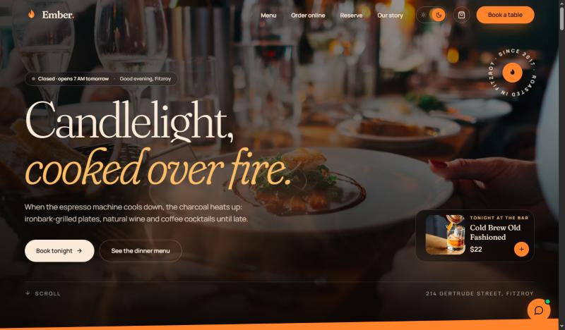
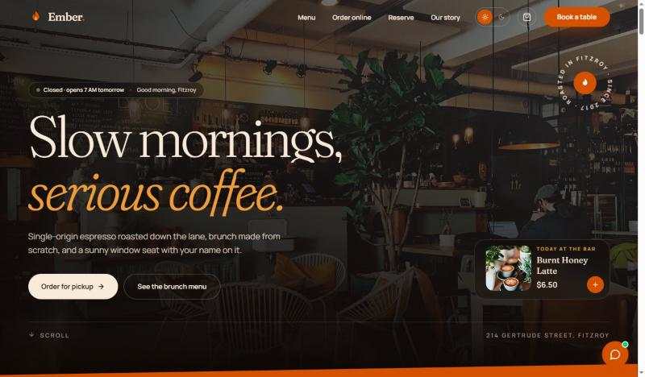

# Ember: café by day, kitchen by night

A multi-page website for a fictional café-restaurant on Gertrude Street, Fitzroy (Melbourne), built to turn visitors into **pickup orders and table bookings** instead of sending them to Uber Eats or a third-party booking app.

**Live demo:** _add your Vercel link here_



## The problem

Most cafés and restaurants have a website that is a menu PDF and a phone number. Guests who want to order or book end up on delivery apps that take 25 to 35% commission, or they simply go elsewhere. Ember shows what a small hospitality business site should do: look as good as the food, and let a guest order or book in under a minute.

## The idea: one site, two moods

Ember is a café in the morning and a fire-cooked dinner spot at night, so the website is too. It follows the clock (café until 5 pm, kitchen after) and a sun/moon switch in the nav flips it by hand. The new mood spreads out of the switch as a growing circle (View Transitions API) and changes the colours, hero photo, headline, featured dishes, today's special and the default menu section.



## Features

- **Editorial, handmade look**: photos set into the headline, pen-drawn underlines and arrows that draw themselves, handwritten notes from the team (Caveat), taped photo prints that drop onto each page hero, and a hero photo that opens from a card to full width as you scroll.
- **Day ↔ Night mode**: a full theme switch from one set of CSS variables, auto-picked from the time of day and remembered once chosen.
- **Steam / smoke hero**: a small hand-written WebGL shader (no library) curls steam over the photo by day and warm smoke by night, follows the pointer, and pauses off screen.
- **Build your cup**: pick base, milk, size, sweetness, extra shot or ice; the SVG glass pours to new layer heights and colours, ice drops in, steam stops when iced, and the price counts to the new total. One tap adds it to the order.
- **Online ordering**: menu with sections, dietary filters (vegetarian, vegan, gluten-free, spicy), search and a quick view with allergens and kitchen notes. Cards glide to their new places on every filter change (GSAP Flip). A dish flies into the bag when added.
- **Cart drawer and checkout**: free-delivery progress bar, an upsell, pickup or delivery, real time slots inside today's opening hours, tip, promo code (`EMBER10`), validation, and a confirmation page with a live order tracker.
- **Table reservations**: three steps (date & guests, time & table, details) with fully booked days, taken slots, seating choice with photos, and a ticket-style confirmation with **Add to calendar (.ics)**. All choices except personal details live in the URL, so the home page and the chat can deep-link straight into step two.
- **AI host "Mia"**: answers hours, location, dietary and price questions, adds dishes to the order, and understands booking requests like *"table for 4 tomorrow at 7pm"*. If that time is taken, the booking page offers the closest free tables. Demo intents in `src/lib/assistant.ts`, shaped so an LLM can replace `answer()`.
- **Live opening status** everywhere ("Open now · until 10 PM" / "Closed · opens 7 AM tomorrow").
- **Motion design**: branded intro with a pour-and-steam loader, curtain page transitions, letter-by-letter hero headline, pinned horizontal signature dishes and timeline, curtain image wipes, parallax gallery, counting stats, two-way review belts, magnetic buttons, custom cursor, velocity skew and Lenis smooth scrolling.
- **Fast photos**: local AVIF with WebP fallback at two sizes with `srcset`, plus an 8 kB set of blurred previews. Inner pages are code-split.
- Reduced-motion support, keyboard and screen-reader friendly controls, fully responsive.

## Re-skin it for a client

Everything a business would change is in **`src/data.ts`**: name, address, hours, dinner start time, menu (with prices, tags, allergens), signature dishes per mood, hero copy, reviews, team, timeline and seating. Swap the photos with `npm run images` (edit the Unsplash IDs in `scripts/fetch-images.mjs`, then run `python scripts/make-lqip.py`). Colours are the CSS variables at the top of `src/index.css`.

## Tech stack

React 19 · TypeScript · Vite · Tailwind CSS v4 · GSAP (ScrollTrigger, SplitText, Flip) · Lenis · WebGL · React Router · Vercel

## Run locally

```bash
npm install
npm run dev
```

Build for production with `npm run build`. The `vercel.json` rewrite makes client-side routes work on Vercel.

Ember is a portfolio concept, not a real business. Photos from Unsplash.
